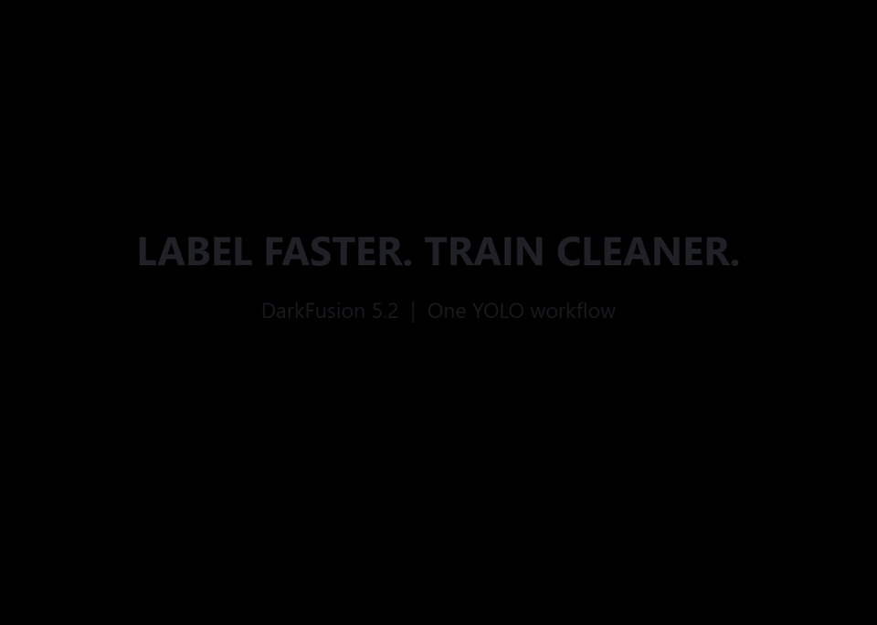
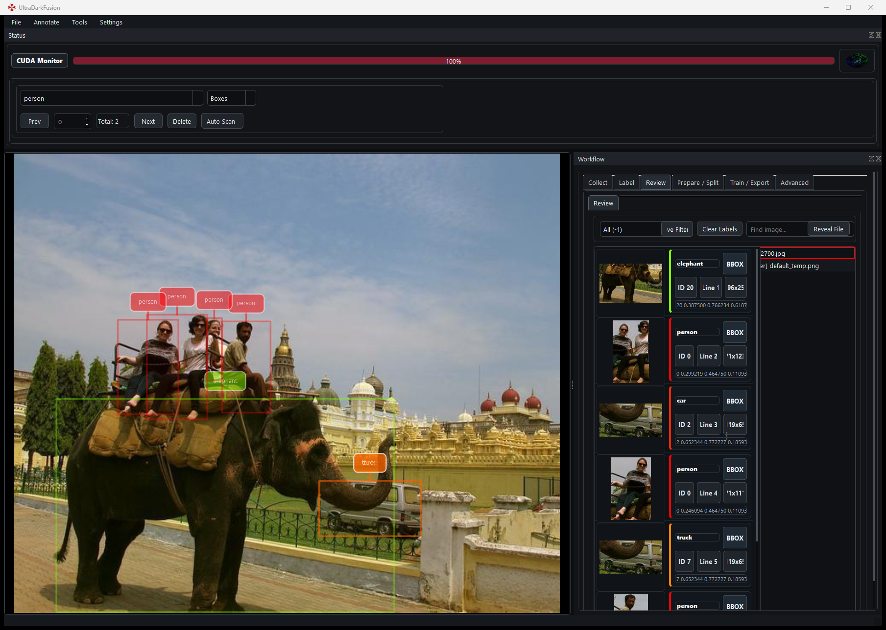

# UltraDarkFusion 5.3.0

> [!IMPORTANT]
> **Before installing or using GPU inference, update Windows and your GPU driver.**
> Check **Settings → Windows Update**, install available updates, and complete any
> required restart after saving your work and finishing training. Use a compatible
> current GPU driver from your PC/GPU manufacturer; setup does not update Windows
> or install GPU drivers.
>
> **Windows 11 24H2 (build 26100) or newer is required for downloadable
> hardware-specific Windows ML providers.** Older supported Windows versions can
> still use CPU/DirectML; provider availability also depends on your GPU and driver.
> Check your version with **Win + R → `winver`**. See
> [Microsoft's Windows Update instructions](https://support.microsoft.com/en-us/windows/deployment/updates-lifecycle/install-windows-updates)
> and [Windows ML provider requirements](https://learn.microsoft.com/en-us/windows/ai/new-windows-ml/supported-execution-providers).



UltraDarkFusion is a Windows desktop application for building YOLO datasets,
labeling images and video, training models, reviewing validation failures, and
running inference through PyTorch, ONNX, or TensorRT.

## Download and install

### Recommended: Windows installer

**[Download DarkFusionSetup.exe for Windows](https://github.com/lordofkillz/DarkFusion/releases/latest/download/DarkFusionSetup.exe)**

1. Download and open **DarkFusionSetup.exe**.
2. Choose a new writable folder and click **Install**.
3. Click **Open DarkFusion** when setup finishes to start the app.

Setup adds a Start menu shortcut by default, and you can also select a desktop
shortcut so DarkFusion is easy to open next time.

Setup automatically downloads and installs the application, its private Python
runtime, and the SAM3/GroundingDINO model bundle into the app's `Sam` folder.
It also includes private, checksum-verified **FFmpeg, FFprobe, and Deno** for
YouTube playback/downloads; no separate media-tool installation or PATH edits
are needed. OpenCV retains its own video decoder for playback and extraction.
**You do not need to install Python, Conda, Git, or build tools.** Download
progress appears in the setup window; interrupted downloads can resume when you
run setup again.

Requires Windows 10 version 1903 or later, or Windows 11 x64, an internet connection,
and approximately **35 GB free during setup**. Setup shows download progress
and verifies the runtime and model files before installing them. NVIDIA drivers
are needed for GPU features.

### Prefer to manage Python yourself?

The [Python installation method](#python-installation) remains available below.
GitHub's **Code → Download ZIP** provides the source for that method. For the
recommended setup experience, use the **Download DarkFusionSetup.exe** link above.

## What changed in 5.3.0

### Latest source updates

- One product version in [VERSION](VERSION), stable application filenames, and
  matching application/installer version information. Use `run_darkfusion.bat`
  or `UltraDarkFusion/UltraDarkFusion.py`; DINO and SAHI keep stable module names.
- Faster shared image loading, reusable Review thumbnails, and unchanged-label
  save skipping preserve the annotation and preview workflow.
- Video decoding, desktop capture, preprocessing, and display use bounded
  background work; frames and their inference overlays retain matching identities.
- Object Clarity supports annotated objects, drawn regions, and the existing
  adjustable ROIs. View-only enhancement preserves source images and labels;
  separate augmentation controls create labeled training variants.
- SAM3 propagation warms after Snap when memory permits and stays ready across
  ordinary Off/On toggles. Training and other heavy GPU jobs reclaim unused
  models and pause optional annotation models until they can be used again.
- Auto Scan repeats the normal navigation workflow with the selected tools and
  delay. Reveal File follows the image currently shown in the editor.
- Standalone folder moves continue when another dataset is opened, with progress
  in their own panel and no completion dialog over other work.
- Native TensorRT setup uses one matching CUDA package family. Windows ML/ONNX
  provider comparisons, TensorRT CUDA graphs, and installer checks are updated.

See the [user guide](USER_GUIDE.md) and [ONNX backend guide](ONNX_RUNTIME_BACKEND.md)
for the current controls and runtime behavior.

### Earlier 5.2.1 updates

- FFmpeg, FFprobe and Deno are now supplied privately for video/YouTube workflows.
  Setup checks the bundled tools themselves, so system-installed copies cannot
  hide missing package files. Source setup downloads the same pinned tools.
- Windows ML is the default runtime for exported `.onnx` models, with
  hardware-aware provider selection and a cached, read-only speed comparison
  per model. `.pt` and `.engine` models retain their native Ultralytics paths.
  WebGPU is an optional experimental provider, not the automatic default.
- Annotation review stays synchronized with saved object IDs after edits and
  deletion. Atomic label replacement protects existing files on write failure.
  Segmentation and OBB labels use the same connected class badges as boxes.
- Keypoint labeling preserves custom point lists and creates editable ghost
  slots when an existing detection has no pose points.
- Save To chooses a destination only; local video, YouTube, desktop and camera
  extraction starts only from Extract. Duplicate Extract/Stop connections are fixed.
- Video frames and inference overlays stay paired; per-frame VRAM polling and
  repeated display/preprocessing work are reduced. Export batch size defaults
  to 1 unless a custom export batch is explicitly selected.
- Propagation can optionally overwrite already labeled frames; it remains off
  by default and preserves reviewed labels when overwrite is disabled.
- Dataset Analysis applies decisive later-pass class checks before expensive
  verification. SAM3 uses confirmed-good review examples and real normalized
  shape measurements, with unchanged references cached across scans. LLM checks
  use the correct object crop and content/model-specific caches; failed requests
  remain unverified and are retried instead of being cached. Conflicting evidence
  stays in review; the scan does not rewrite labels or suggest missing objects.
- Teammate-ignore auto labeling uses conditional, compact nameplate OCR; its
  CLIP and OCR models are cached after their first-use downloads.
- SAM3 shape analysis uses annotations explicitly reviewed and kept as its reference, with
  conservative handling when there is not enough reference data.
- Six new DF themes have matching names, GIFs, icons, and panorama artwork
  behind the upper Status dock controls. Idle artwork disappears when an image
  is displayed.
- The updated Windows installer removes duplicate runtime archive entries,
  and source installation uses one consistent pinned dependency list.
- Video renderer changes apply immediately from Settings.
- DINOv3 Base/Large visual matching and DINOv3 visual class outlier analysis,
  with verified model downloads on first use. Base downloads 343 MB; Large
  downloads 1.21 GB. See [model setup](MODEL_SETUP.md).
- UI language changes use cached JSON immediately and translate missing text in
  the background. File names, model paths, stylesheet choices, and class data
  retain their original values. New translations are saved for future launches.
- Manually drawn labels on extracted video frames seed propagation correctly.
- Updated annotation, review, and display controls, including a cursor-anchored
  zoom correction found during release testing.

## Short walkthrough

The walkthrough uses COCO images inside the current UltraDarkFusion 5.2
interface. It demonstrates accurately fitted boxes, polygon segmentation, OBB,
pose/keypoints, the visual review workflow, AI-assisted dataset tools, and the
integrated Trainer's live metrics, health charts, and validation review.

[Watch or download the 25-second MP4](samples/darkfusion_walkthrough.mp4)

## DarkFusion at a glance

DarkFusion keeps the full image, individual annotation previews, dataset
navigation, and editing tools together in one workspace. It supports bounding
boxes, polygon segmentation, pose/keypoints, and OBB. Left-click a preview to
locate and flash its exact annotation on the full image.



The short walkthrough above also shows the annotation modes and the integrated
Trainer used to evaluate, train, tune, validate, and export models.

New users should follow the
[complete DarkFusion workflow guide](USER_GUIDE.md) for collecting images,
video and YouTube frame extraction, manual and automatic labeling, Dataset
Analysis, training, tuning, and validation review.

## Current capabilities

- Compact **System Monitor** with GPU load, temperature and board power,
  VRAM, system and busiest-thread CPU load, RAM, drive usage, and DarkFusion
  memory usage. Text size is adjustable.
- Prominent training time remaining and estimated finish time in Live Metrics.
- Optional hover/drawing measurements in image pixels and a small blank-image
  status badge that scales with the displayed image. Both have separate
  controls under **Settings → General → Display**.
- Bounding-box, polygon segmentation, pose/keypoint, and oriented-box labeling.
- Zoom, pan, snap-assisted editing, configurable frame skipping, and batch
  dataset workflows.
- SAM3-assisted snapping, segmentation conversion, object effects, and
  augmentation with cancellation controls.
- Stable Diffusion inpainting that removes labeled objects to create
  hard-negative images with empty labels.
- GroundingDINO and YOLO-based automatic labeling.
- Integrated Ultralytics Trainer with dataset evaluation and health checks,
  image-size recommendations, batch calibration, hyperparameter/Ray tuning,
  knowledge distillation, validation, and detached background runs.
- Live metrics and health/loss charts, artifact viewer, safe
  stop-after-epoch/stop-now controls, resume support, run-folder access, and
  checkpoint access.
- Validation Review for false positives, missed ground truth, wrong classes,
  weak localization, duplicates, and poor keypoints across detect, segment,
  pose, OBB, and classify tasks.
- Per-annotation and false-detection negative crops that retain available
  context, exclude other saved annotations, preserve native resolution, and
  share the dataset's `blanks` folder. Short dimensions are padded to at least
  32 pixels without forcing square crops.
- Similar-annotation review with an adjustable match threshold, shape-aware
  comparisons, and removal of selected matching labels.
- Dataset analysis for mixed annotations, invalid labels, small targets,
  class balance, model stride, candidate image sizes, and task-aware
  segmentation mask resolution, plus visual annotation outliers. Analysis
  stays within the selected dataset.
- PyTorch `.pt`, standalone ONNX Runtime `.onnx`, TensorRT `.engine`, and
  legacy Darknet model workflows, with selectable ONNX Runtime execution
  providers and shared thresholds, colors, resizing, and TXT output.
- SAHI/tiled inference, tracking, frame extraction, camera/desktop capture,
  themes, 19 bundled offline interface languages, and voice-assisted class
  selection.

## Supported system

- Windows 10/11, 64-bit.
- For the Python installation: Miniconda or Anaconda and Python 3.12 in a
  dedicated environment (`fusion` by default).
- For the standalone package: Windows 10 version 1903 or later, or Windows 11;
  Python and its dependencies are included.
- NVIDIA GPU and current driver recommended.
- The pinned PyTorch build uses CUDA 13.0 and supports modern NVIDIA GPUs,
  including Blackwell/RTX 50-series. CUDA training requires an NVIDIA driver
  from branch 580 or newer; update the driver before using the new runtime.
- Windows ONNX inference uses Windows ML's hardware-aware Automatic selection,
  with a read-only, cached per-model provider speed comparison by default and
  selectable DirectML and compatible catalog providers. PyTorch/CUDA training
  remains separate; provider setup does not replace the training environment.
- Downloadable hardware-specific Windows ML providers require Windows 11 24H2
  (build 26100) or newer and compatible GPU/NPU drivers. CPU/DirectML remain
  available on older supported Windows versions.

The normal Python installation does not require compiling OpenCV or installing
a separate CUDA Toolkit. The PyTorch wheel provides its matching CUDA runtime.
A locally installed CUDA Toolkit is only needed for specialized source builds.
Use only trusted models and configuration files; see [model safety](SECURITY.md).

### If Windows crashes or restarts

A stop code such as `IRQL_NOT_LESS_OR_EQUAL (0xA)` is a Windows kernel/driver
failure, not proof that Windows is outdated. If it occurs while using DarkFusion,
report your DarkFusion version, `winver` result, GPU/driver version, selected
model/provider, and the action that triggered it. A crash dump can help identify
the cause; share dumps privately, not in a public GitHub issue. See
[Microsoft's explanation of this stop code](https://learn.microsoft.com/en-us/windows-hardware/drivers/debugger/bug-check-0xa--irql-not-less-or-equal).

## Python installation

Use this method to install from the repository and manage DarkFusion's Python
environment. For the separate native setup package, see
[Download and install](#download-and-install).

Install [Git](https://git-scm.com/download/win) and
[Miniconda](https://docs.conda.io/projects/miniconda/en/latest/), then:

```powershell
git clone https://github.com/lordofkillz/DarkFusion.git C:\DarkFusion
cd C:\DarkFusion
.\fusion_install.bat
```

For complete SAM3 snapping, segmentation, augmentation, and GroundingDINO
auto-labeling, also install the
[DarkFusion 5.2 required model bundle (3.84 GB)](https://drive.google.com/file/d/1j9Y-WpUDjPt67_U43lafO-7dTkxLJuPS/view?usp=sharing).
Open the downloaded ZIP and copy its `Sam` folder into
`C:\DarkFusion\UltraDarkFusion`. The resulting paths must include:

```text
C:\DarkFusion\UltraDarkFusion\Sam\sam3.pt
C:\DarkFusion\UltraDarkFusion\Sam\groundingdino_swint_ogc.pth
```

The installer:

1. Finds Miniconda/Anaconda without assuming a username-specific path.
2. Creates `fusion` with Python 3.12 when needed.
3. prevents packages from leaking into the user-site directory.
4. installs the pinned CUDA/ML/UI environment from `requirements.txt`.
5. installs and verifies the private FFmpeg/FFprobe/Deno tools.
6. installs the signed matching Microsoft Windows App SDK runtime if missing.
7. verifies the application files and critical imports.

Launch DarkFusion with:

```powershell
.\run_darkfusion.bat
```

The launcher also finds standard Miniconda/Anaconda installations when Conda
is not on `PATH`. To use a separate environment, use the same name when
installing and launching:

```powershell
.\install.ps1 -EnvironmentName fusion-test
.\run_darkfusion.bat fusion-test
```

The installer uses the package indexes in this repository and ignores local
pip configuration for the installation, without changing that configuration.

Manual installation is also supported:

```powershell
conda create -n fusion python=3.12.15 -y
conda activate fusion
$env:PYTHONNOUSERSITE = "1"
python -m pip install --upgrade pip setuptools wheel
python -m pip install --no-user -r requirements.txt
python scripts\verify_install.py
python UltraDarkFusion\UltraDarkFusion.py
```

## Models

Large model files are not stored in the Git repository. Download the
[required model bundle](https://drive.google.com/file/d/1j9Y-WpUDjPt67_U43lafO-7dTkxLJuPS/view?usp=sharing)
and extract its `Sam` folder into `UltraDarkFusion` to enable all bundled SAM3
and GroundingDINO features. The application can launch without these
checkpoints, but those model-assisted tools will be unavailable. YOLO and
YOLOE models can be selected from any local location.

See [MODEL_SETUP.md](MODEL_SETUP.md) for the exact model layout and TensorRT
export notes. See
[ONNX_RUNTIME_BACKEND.md](ONNX_RUNTIME_BACKEND.md) for the
standalone ONNX backend, provider selection, TensorRT caching, and parity tests.

## What belongs in the repository

The repository contains the application source, generated PyQt UI module,
editable `.ui` file, training/validation worker scripts, styles, icons, sounds,
translations, sight overlays, installer, dependency manifest, user guide, and
verification tooling.

The following stay local and are ignored:

- `.env`, `settings.json`, databases, and machine-specific configuration.
- datasets, labels, split lists, run directories, and validation reports.
- `.pt`, `.pth`, `.weights`, `.onnx`, `.engine`, and other model artifacts.
- videos, archives, caches, debug output, recovered copies, and backups.

For large public checkpoints, use a GitHub Release or a dedicated model host
instead of committing them to normal Git history.

## Community and acknowledgments

- [UltraDarkFusion Discord](https://discord.gg/fZTz8E44)
- [Ultralytics](https://github.com/ultralytics/ultralytics)
- [GroundingDINO](https://github.com/IDEA-Research/GroundingDINO)
- [SAHI](https://github.com/obss/sahi)
- [Darknet](https://github.com/hank-ai/darknet)
- Inspired by [DarkMark](https://github.com/stephanecharette/DarkMark)

UltraDarkFusion is licensed under the
[GNU Affero General Public License v3](LICENSE.txt).
